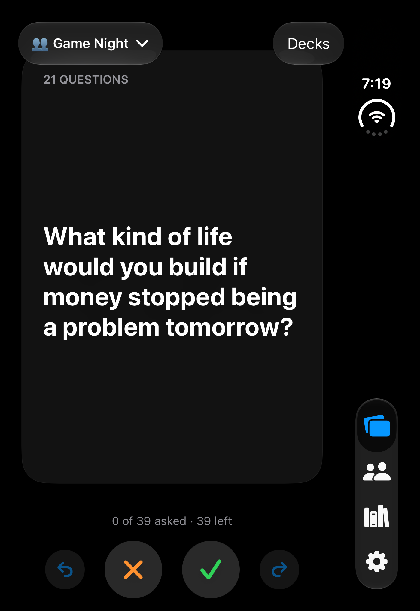
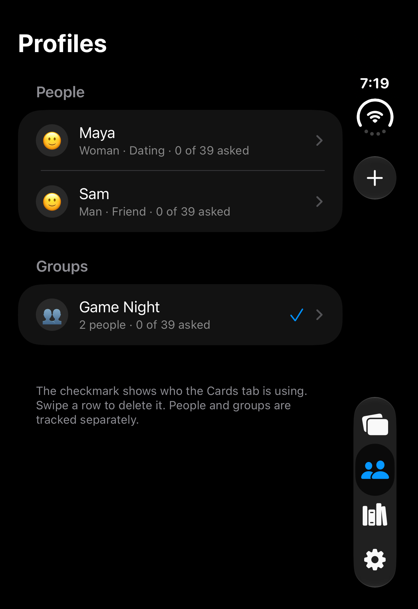

# Flashcards: Offline Conversation Cards for iPhone


> An offline iPhone app of conversation cards. Swipe through icebreakers, small-talk upgrades, dares and "this or that" prompts with one person or a group, and never ask the same profile the same card twice.

## Screenshots

| Safe starter card · Dark mode | People and groups · Dark mode |
|---|---|
|  |  |
| A sample card from the public **21 Questions** deck. | Sample profiles and a group; each has its own progress. |

## What it does
- **Swipe cards.** Right = asked, left = skip (the card returns later). Undo and Redo cover accidental swipes.
- **People and groups.** Each person has their own asked list, answers and deck choices. A group is made of people you already added and tracks its own asked cards and answers, separate from its members.
- **Optional answers.** After a right swipe, a sheet offers a note, the picked option (multiple choice, this or that) and, in a group, who answered. Dismiss it to save nothing; the card still counts as asked.
- **Decks.** Turn decks on or off per profile. Add your own questions, "this or that" and multiple-choice cards.
- **Backup.** Export everything as one SQLite file to any location (Files, AirDrop) and import it back. Import keeps a safety copy first.
- **Dark mode.** True black, or follow the system.

No accounts, no network, no analytics. All data stays on the phone.

## Quick Start

Requires macOS with Xcode 16 or later and [XcodeGen](https://github.com/yonaskolb/XcodeGen).

```bash
# Clone and set up
git clone https://github.com/ihiteshmodi/flashcard-app.git
cd flashcard-app
brew install xcodegen
scripts/bootstrap.sh

# Verify the core works (no simulator needed)
swift test
# Expected: Executed 178 tests, with 0 failures

# Run the app
open Flashcards.xcodeproj    # choose the Flashcards scheme, then Run
```

`scripts/bootstrap.sh` creates an empty `Generated/seed.json` (if missing) and generates `Flashcards.xcodeproj`. The number of tests grows as features are added; the line should always end in `0 failures`.

A fresh clone starts with one deck, **21 Questions** (40 get-to-know-you questions in four themes such as Values & Character and Ambition & Personal Growth), so the app is usable straight away. Add your own cards in the Library tab, or build more decks from your own export (see [Bundled decks](#bundled-decks)).

To run on a real iPhone, set your signing team on the Flashcards target in Xcode.

To sideload without Xcode signing (for example into LiveContainer, which signs the app itself), build an unsigned IPA:

```bash
scripts/build-unsigned-ipa.sh
# Created build/Flashcards-unsigned.ipa
```

The IPA embeds your private `Generated/seed.json` (when you have one), so keep it out of git (`build/` is ignored) and do not share it.

## Usage

### In the app
1. **Profiles** tab: add a person (name, optional emoji, gender Woman or Man, and closeness Friend, Dating or Partner). Add a group from the same menu and tick its members. Open a person to move them from Friend to Dating to Partner with one tap.
2. **Cards** tab: pick who you are talking to with the name at the top, then swipe. Use ✓ / ✕ and the Undo / Redo buttons if you prefer taps.
3. After a right swipe, type the answer in the sheet and tap **Save Answer**, or tap **Not Now**.
4. Open a profile to see its **History**, change its **Decks**, or (for groups) edit **Members**.
5. **Library** tab: add your own cards (any deck, category, tip line, Dare kind, and the three labels below). **Settings** tab: who you are ("I am"), export, import, appearance.

### Who sees which card
Every card has three labels: **Who it's for** (Everyone, Women, Men, Couples), **How spicy** (Safe, Flirty, Explicit) and **Worded for** (Anyone, A man's view, A woman's view). A profile is shown a card only when all three fit:

| Label | Shown when |
|---|---|
| Spice | Safe to everyone; Flirty to Dating and Partner; Explicit to Partner |
| Who it's for | Everyone to all; Women or Men to that gender; Couples to Dating and Partner |
| Worded for | A man's view needs "I am: Man"; a woman's view needs "I am: Woman"; hidden when "I am" is not set |

A person with no gender, and every group, only sees Everyone, Safe cards. Progress and deck counts count only the cards a profile can see; a card hidden by a later change stays in its history. Existing profiles from an older backup have no gender and closeness Friend until you set them.

### From code
Everything the screens do goes through one object, `Flashcards`. This is the same code the tests use:

```swift
import FlashcardsCore

let app = try Flashcards(database: Database.inMemory())   // use Database(path:) for a file
try app.loadSeed(seedJSONData)                            // e.g. the contents of app/resources/DemoDecks.json

let maya = try app.profiles.addPerson(name: "Maya", emoji: "🌸")
let session = try app.session(for: maya.id)

print(session.topCard?.prompt ?? "no cards")
// What is a belief you changed your mind about?

let asked = try session.swipeRight()                      // marks it asked for Maya only
try app.answers.save(profileID: maya.id, cardID: asked!.id, text: "Used to hustle every day", pickIndex: nil)

print(try app.answers.history(profileID: maya.id).first?.answer?.text ?? "")
// Used to hustle every day

try session.undo()                                        // card is back on top, answer is kept
try session.redo()                                        // asked again
```

Groups keep their own state:

```swift
let sam = try app.profiles.addPerson(name: "Sam")
let friends = try app.groups.createGroup(name: "Friends", emoji: "🍻", memberIDs: [maya.id, sam.id])

let groupCard = try app.session(for: friends.id).swipeRight()!
try app.answers.save(profileID: friends.id, cardID: groupCard.id, text: "Calls park security", pickIndex: nil, answeredBy: "Sam")

print(try app.session(for: maya.id).progress)
// Progress(asked: 1, total: 6)   // Maya's own asked count, unaffected by the group
```

Backup:

```swift
let file = FileManager.default.temporaryDirectory.appendingPathComponent(app.backup.suggestedFileName())
try app.backup.export(to: file)             // flashcards-2026-10-29.sqlite
let info = try app.backup.inspect(file)     // BackupInfo(schemaVersion: 1, profileCount: 3, answerCount: 2)
```

## Configuration

The app needs no environment variables or secrets.

| Setting | Where | Default | Required |
|---|---|---|---|
| Database file | `Application Support/flashcards.sqlite` on the device | created on first launch | No |
| Safety copies on import | `Documents/Safety Copies/` (visible in Files under "On My iPhone") | created when needed | No |
| Appearance | Settings tab | System | No |
| Bundled decks | `app/resources/StarterDecks.json` (public: the 21 Questions deck) and `Generated/seed.json` (private, git-ignored) | starter deck plus an empty placeholder from `scripts/bootstrap.sh` | No |
| Launch arguments `-UITestInMemory -UITestDemoData` | Xcode scheme or `xcodebuild` | off | No (used by UI tests: in-memory database, made-up demo decks, cards in deck order) |

If the database cannot be opened, or the seed file is unreadable, the app shows a "Flashcards Could Not Start" screen instead of running with missing data.

## Bundled decks

The app bundles two deck files and loads them in this order at every launch:

1. `app/resources/StarterDecks.json`: the public **21 Questions** deck, committed to the repository.
2. `Generated/seed.json`: your own decks, private and git-ignored.

Both use stable card ids, so a deck that appears in both files is updated in place, never duplicated.

To build your own decks, `tools/build-seed` turns a Notion HTML export (a `.html` file or the `.zip` Notion produces) into the JSON the app bundles:

```bash
python3 tools/build-seed/build_seed.py "Internal Artifacts/<export>.zip" Generated/seed.json
# General Questions: 180 cards
# About You Two: 5 cards
# ... one line per deck
scripts/bootstrap.sh
```

`Internal Artifacts/` and `Generated/` are git-ignored. Card ids are stable (`general-001`), so rebuilding the seed with corrected text keeps every asked mark and answer. The card text is copied exactly; only HTML and wrapping quotes are cleaned.

One flashcard holds one question. When a source line holds two standalone questions ("What do you like most? What do you like least?"), the builder makes two cards with ids `general-007a` and `general-007b`; other ids do not shift. A follow-up that needs the first sentence ("If yes, ..."), or a sentence that lists the options of the first question, stays on the same card. A card that leaves the seed is removed from the app on the next launch unless it was already asked or answered. To refresh the public starter deck from an export:

```bash
python3 tools/build-seed/build_seed.py "Internal Artifacts/<export>.zip" app/resources/StarterDecks.json --only 21-questions
```

The builder labels each card from its deck, category and wording (`tools/build-seed/classify.py`; a keyword can only raise a card's spice). Defaults are left out of the JSON. Optional card fields: `audience` (`everyone`, `women`, `men`, `couples`), `spice` (`safe`, `flirty`, `explicit`), `perspective` (`anyone`, `man`, `woman`).

Card shapes the app understands:

| Kind | Looks like |
|---|---|
| `question` | A single prompt |
| `topic` | A prompt with a tip underneath |
| `upgrade` | A better question with "Instead of: ..." underneath |
| `dare` | An action with a detail line; no answer sheet |
| `multipleChoice` | A scenario with options a, b, c |
| `thisOrThat` | Two options with OR between them |

Seed file format:

```json
{
  "version": 1,
  "decks": [
    {
      "id": "deep",
      "title": "Deep Talk",
      "cards": [
        {"id": "deep-001", "kind": "question", "category": "Values", "prompt": "What small thing instantly improves your mood?"},
        {"id": "deep-002", "kind": "multipleChoice", "prompt": "You find a wallet. Do you...", "options": ["Hand it in", "Look for the owner", "Leave it"]}
      ]
    }
  ]
}
```

## Core API reference

All types live in the `FlashcardsCore` Swift package (`src/`). Methods throw; the messages below are the ones shown to the user.

| Area | Calls |
|---|---|
| Profiles | `profiles.addPerson(name:emoji:gender:closeness:)`, `setGender(of:to:)`, `setCloseness(of:to:)`, `setOwnerGender(_:)`, `owner.gender()`, `rename(_:to:)`, `delete(_:)`, `impactOfDeleting(_:)`, `people()`, `groups()`, `select(_:)`, `selectedProfile()` |
| Groups | `groups.createGroup(name:emoji:memberIDs:)`, `members(of:)`, `addMembers(_:to:)`, `removeMember(_:from:)` |
| Decks | `decks.rows(for:)`, `decks.setDeck(_:on:for:)`, `catalog.decks()`, `catalog.cards(in:)` |
| Swiping | `session(for:)` returns a `CardSession` with `topCard`, `stack`, `progress`, `swipeRight()`, `swipeLeft()`, `undo()`, `redo()`, `startOver()`, `syncWithLibrary()` |
| Answers | `answers.save(profileID:cardID:text:pickIndex:answeredBy:)`, `answer(profileID:cardID:)`, `history(profileID:onlyWithAnswers:)`, `answerers(forGroup:)` |
| Own cards | `customCards.add(kind:prompt:options:deckID:category:detail:audience:spice:perspective:)`, `edit(_:prompt:options:deckID:category:detail:audience:spice:perspective:)` (replaces every field), `delete(_:)`, `answersLost(ifDeleting:)`, `categories(inDeck:)`, `cards()` |
| Backup | `backup.export(to:)`, `inspect(_:)`, `restore(from:)`, `suggestedFileName()`, `lastExportedAt` |
| Seed | `loadSeed(_:)` |

Rules worth knowing:

- Saving an answer with an empty note and no pick removes the answer.
- Undo restores the card but never deletes its saved answer; the entry stays hidden from history until the card is asked again.
- `startOver()` clears asked and skipped marks only. Answers stay.
- A group never marks cards asked for its members, and a person never affects a group.

Errors:

| Error | Message | When |
|---|---|---|
| `ProfileError.emptyName` | Enter a name | Blank name |
| `ProfileError.duplicateName` | A profile named Maya already exists | Names are unique across people and groups, ignoring case |
| `ProfileError.noMembers` | Pick at least one person | Group created without members |
| `ProfileError.lastMember` | A group needs at least one person | Removing the only member |
| `DeckChoiceError.keepOneDeckOn` | Keep at least one deck on | Turning off the last deck |
| `CustomCardError.emptyPrompt` | Enter the question | Blank card text |
| `CustomCardError.needAtLeastTwoOptions` | Add at least two options | Multiple choice with fewer than two options |
| `CustomCardError.builtInCard` | Built-in cards cannot be changed | Editing or deleting a bundled card |
| `BackupError.notABackup` | This file is not a Flashcards backup | Import of an unrelated file |
| `BackupError.newerVersion` | This backup is from a newer version of the app. Update the app first. | Import from a newer schema |

## Tests

```bash
swift test                                        # core rules against a real in-memory SQLite, no simulator
python3 -m unittest discover tools/build-seed     # seed builder
xcodebuild test -project Flashcards.xcodeproj -scheme Flashcards \
  -destination 'platform=iOS Simulator,name=<your simulator>'    # UI flows (slow; several minutes)
```

The scenarios the tests come from are plain-language `.feature` files next to the tests: `tests/<capability>/<feature>/<feature>.feature`.

## Project layout

```
src/modules/<capability>/<feature>/   rules and services per feature (play, people, library, data)
src/shared/                           Database, migrations, Roles (clock, shuffle, ids)
src/Flashcards.swift                  the application interface used by the app and the tests
app/                                  SwiftUI screens (thin), composition root, demo decks
tests/<capability>/<feature>/         .feature scenarios + XCTest specs; tests/ui for simulator flows
tools/build-seed/                     importer for the private deck export
docs/design/flashcards/               impact map, architecture, test strategy
```

Design notes live in [docs/design/flashcards](docs/design/flashcards): the [impact map](docs/design/flashcards/impact-map.md) (who, why, what), the [architecture](docs/design/flashcards/architecture.md) and the [test strategy](docs/design/flashcards/test-strategy.md).

## Adding a feature
1. Write scenarios in `tests/<capability>/<feature>/<feature>.feature` and get them agreed.
2. Add tests next to it, starting from `tests/support/World.swift`, and watch them fail for the right reason.
3. Implement in `src/modules/<capability>/<feature>/` and expose it through `Flashcards`.
4. Keep screens thin: parse input, call one service, show the result.
5. Commit only on green, one feature per commit.

## Privacy
Nothing leaves the device unless you export or share a backup yourself. The repository contains no personal data. The only card content in it is the public 21 Questions starter deck; every other deck stays in git-ignored folders.
