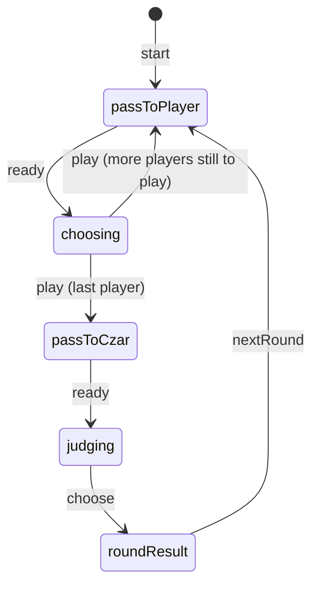

# Play the game: state machine

One round of a `Game`. Everything else (scores, hands, piles) changes only through these transitions.

## Invariants
- Between `start` and the end there are always 3 to 10 players with distinct names, and a Czar who is one of them.
- A hand is readable only in `choosing`, and only the hand of the player named by the phase.
- A player plays exactly `pick` cards, all from that player's own hand, none twice.
- The Czar never plays; every other player plays exactly once per round.
- The plays shown to the Czar carry no names and are in the order the shuffle gave.
- A point is awarded only in `choose`, to the player of the chosen play, once.
- At the start of every round each player holds the hand size again, and no card is in two places.

## Forbidden arrows (each has a test)
`play` outside `choosing`; `ready` in `choosing`, `judging` or `roundResult`; `choose` outside `judging`, or with a play that does not exist; `nextRound` outside `roundResult`; reading a hand outside `choosing`.
