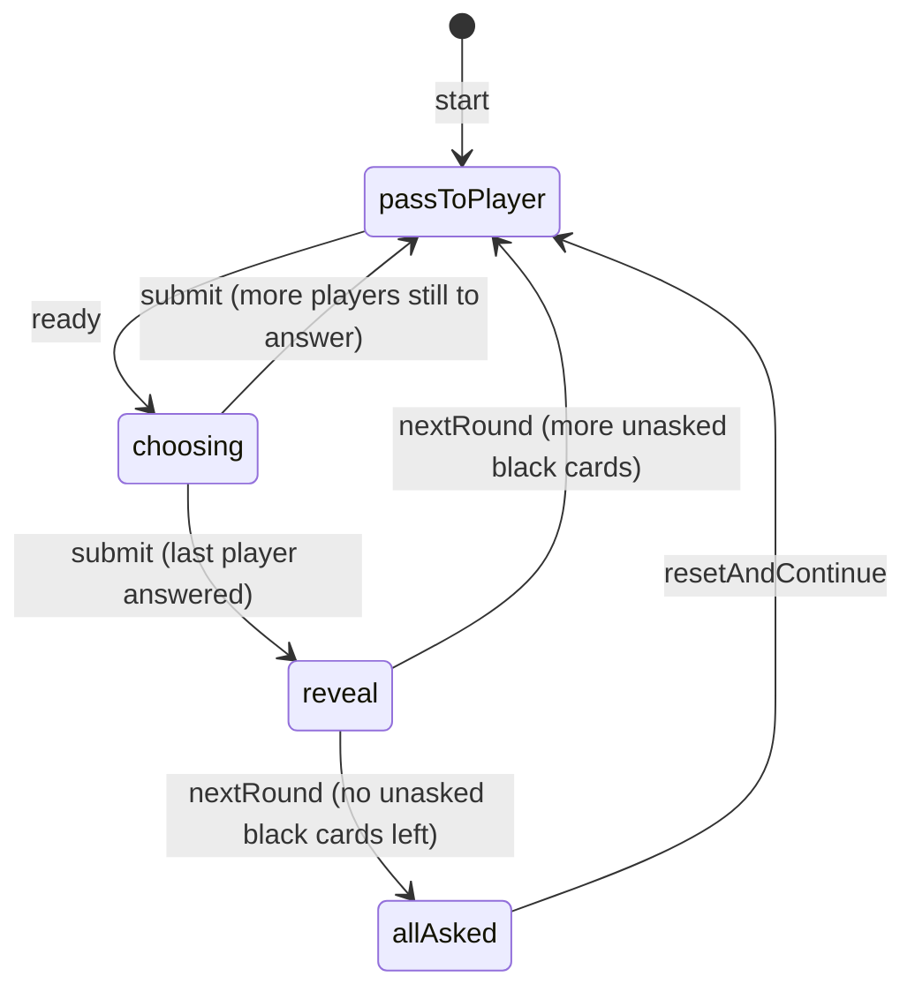

# Play the game: state machine

One round of a `Game`. Every player answers the same black card from the same round options; picks stay hidden until the last player finishes.

## Invariants
- Between `start` and the end there are 1 to 10 players with distinct identities/names.
- Every player in a round sees the exact same list of white option cards (`options`, up to 12 cards).
- A player's choice is not visible to any other player during `passToPlayer` or `choosing`; choices are readable only in `reveal`.
- Two players may choose the exact same white card(s) in the same round, and white cards remain eligible in later rounds.
- Within a single multi-pick answer (`Pick 2` or `Pick 3`), a player chooses `pick` distinct white cards from the round's options, kept in the order chosen.
- Every player answers once per round, in player order.
- Entering `reveal` records the asked black card and every player's answer to History (on the Group if playing as a group, otherwise on each participating Person profile).
- Black cards already asked for the Group (or already asked for every participating Person) are excluded until reset; resetting clears the asked marks while preserving saved History entries.

## Forbidden arrows (each has a test)
`submit` outside `choosing`; `ready` outside `passToPlayer`; `nextRound` outside `reveal`; reading players' answers before `reveal`; choosing a card not in the round's options or fewer/more than `pick` cards.
